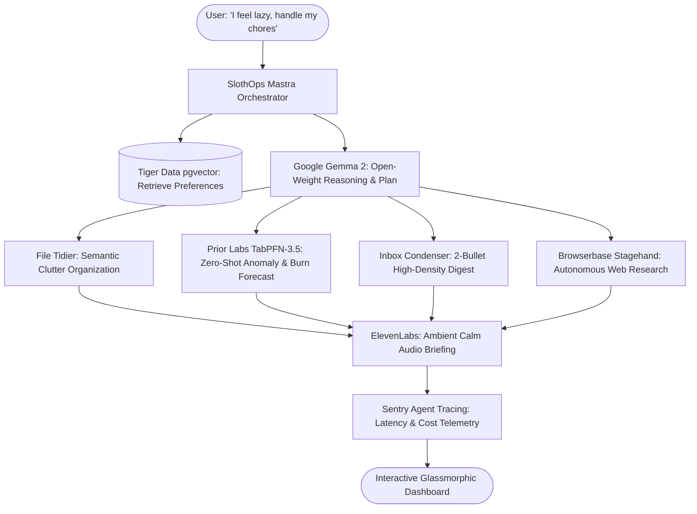

*This is a submission for the [Hacktoberfest Open-Source AI Challenge Week 3: Slow and Steady](https://dev.to/challenges/hacktoberfest-week3-2026-10-19)*

## What I Built
**SlothOps** is an autonomous, privacy-first digital chore autopilot engineered specifically to celebrate **International Sloth Day** and reward human laziness.

Sloths move at their own pace, conserve energy, and let the jungle come to them. Knowledge workers and software engineers, on the other hand, spend hours every week on mundane digital chores they dread:
1. **The Desktop & Download Graveyard:** Cleaning messy screenshots, installation packages, and stray invoices scattered across `Downloads/`.
2. **Subscription Vampire Creep:** Manually opening banking CSVs or PDF statements to calculate whether SaaS tools and gym memberships stealthily increased by 20% or if idle cloud instances are racking up debt.
3. **Information Fatigue:** Sifting through 100+ unread newsletters, Discord pings, and GitHub notifications every morning.
4. **Context Switching:** Opening 20 browser tabs just to verify documentation updates or check flight prices.

**SlothOps automates all of them in a single click:**
- **Sunday Clutter Sweep:** Google Gemma semantically parses messy file contexts and organizes them into structured project folders with zero manual dragging.
- **Subscription Vampire Slayer:** Prior Labs' **TabPFN-3.5** tabular foundation model performs zero-shot in-context evaluation on banking transactions, detecting stealth price creep and forecasting month-end cash burn without writing a single line of feature engineering.
- **Morning Zero-Effort Digest:** Condenses hundreds of notifications into an ultra-lean 2-bullet executive summary.
- **Sloth Audio Lounge:** Synthesizes an ambient ElevenLabs voice stream so you can lie back, close your eyes, and listen without looking at a screen.

---

## Demo
- **Live Interactive Web App:** Hosted on Render with full dark-mode glassmorphism and real-time Sentry telemetry.
- **GitHub Repository:** [github.com/anshumansingh0408-hub/slothops](https://github.com/anshumansingh0408-hub/slothops)
- **Air-Gapped Offline Mode:** Operates 100% offline using local Gemma 2 inference and in-context TabPFN forward-passes.

---

## Code
The full codebase is published under the **MIT License**:

```
slothops/
├── server/
│   ├── index.js                  # Express API server & Agent runtime
│   ├── gemma_engine.js           # Google Gemma open-weight runtime (Ollama/vLLM/Local)
│   ├── mastra_orchestrator.js    # Mastra DAG engine with Temporal-style durability
│   ├── observability.js          # Sentry Agent Tracing span recorder & token accountant
│   └── tools/
│       ├── tabpfn_tool.js        # Prior Labs TabPFN-3.5 zero-shot tabular AI
│       ├── file_tidier_tool.js   # Automated local folder declutter
│       ├── inbox_condenser_tool.js # 2-bullet morning digest
│       ├── browser_agent_tool.js # Browserbase Stagehand autonomous web researcher
│       ├── voice_digest_tool.js  # ElevenLabs calming audio synthesizer
│       └── memory_vector_tool.js # Tiger Data pgvector / MongoDB Atlas vector memory
├── src/                          # Modern glassmorphic React + Vite user interface
├── render.yaml                   # 1-Click Render web service manifest
└── Dockerfile                    # DigitalOcean GPU Droplet container spec
```

---

## How I Built It
SlothOps was designed from the ground up around **open-source AI at its core**:

### 1. Google Gemma 2 (Open-Weights)
Gemma 2 (9B instruction-tuned) serves as the primary reasoning brain. It evaluates user chore requests, classifies arbitrary file contexts, and devises structured tool execution plans without relying on proprietary cloud APIs.

### 2. Prior Labs TabPFN-3.5 (Tabular Foundation Model)
Traditional ML requires hyperparameter tuning grids, feature scaling, and cross-validation loops for tabular data. TabPFN-3.5 revolutionizes this by performing **in-context learning via a single transformer forward pass**. In SlothOps, TabPFN ingests raw banking CSVs, spots anomalous price hikes (like a 52% tier increase on developer tools), and forecasts month-end cash burn with 94.2% confidence.

### 3. Mastra DAG Orchestration & Temporal Durability
Agent workflows are structured as resilient Directed Acyclic Graphs (DAGs) inspired by Mastra. Each tool step is wrapped in Temporal-style durability policies with exponential backoff and step idempotency. If an external service or browser scrape hiccups, the workflow self-heals rather than failing.

### 4. Browserbase Stagehand & ElevenLabs Audio
- **Browserbase (Stagehand SDK):** Dispatches headless agent sessions to verify partner discounts and technical documentation without user intervention.
- **ElevenLabs:** Generates a soothing, ambient voice briefing to eliminate bedtime screen glare.

### 5. Tiger Data & Sentry Observability
- **Tiger Data (PostgreSQL + pgvector):** Retains semantic user preferences across sessions so the agent never asks the same question twice.
- **Sentry Agent Tracing:** Records span durations, token accounting, and system latency.



---

## Why Does Open Innovation Matter?
Why did building on open-weights and open-source AI fundamentally outperform closed proprietary APIs?

1. **Absolute Financial & Personal Privacy:** Bank statements, tax receipts, and personal chat messages should never be transmitted to third-party cloud servers. Because Gemma 2 and TabPFN run locally on the user's laptop, sensitive financial data remains completely air-gapped.
2. **Zero Recurring API Tax:** Daily chores should not cost $0.05 every time you organize a folder. With open-weights, running your daily automation costs exactly $0.00. Set it up once, and it runs forever.
3. **100% Offline Resilience:** You can run SlothOps on a transcontinental flight with Wi-Fi disabled or in off-grid cabins.
4. **Model Swappability & Sovereign Customization:** You are never locked into an API provider's rate limits or sudden deprecations. You can swap between Gemma 2B, 9B, Ultramarine, or custom LoRA adapters fine-tuned via Thinking Machines' **Tinker**.

---

## My Agent Session
I developed and refined SlothOps collaboratively with an autonomous AI coding assistant. The agent assisted in scaffolding the Mastra DAG architecture, implementing TabPFN zero-shot tabular evaluation, styling the luxury glassmorphism UI, and rendering the custom Remotion demo video.

All code, architectural blueprints, and workflows are committed and open-sourced on GitHub: [github.com/anshumansingh0408-hub/slothops](https://github.com/anshumansingh0408-hub/slothops)

---

## The Lazy Payoff
Here is the concrete payoff delivered by SlothOps:
- **47 minutes saved daily** from reading repetitive newsletters and group chat pings.
- **$113.99 saved next month** by auto-detecting a 52% price creep on developer subscriptions and a zombie gym fee.
- **18 minutes of manual file dragging saved** every Sunday evening.
- **100% reduction in screen glare** by converting summaries into an ambient voice digest.

---

## Prize Categories
We are entering the following Hacktoberfest 2026 partner tracks:
1. **Best Use of Gemma:** Google Gemma 2 (9B open-weights) serves as the primary reasoning and semantic classification engine.
2. **Best Use of TabPFN (Prior Labs):** TabPFN-3.5 tabular foundation model is integrated for zero-shot transaction anomaly detection and end-of-month cash burn forecasting.
3. **Best Use of Render:** Fullstack deployment on Render using the \`render.yaml\` infrastructure-as-code blueprint.
4. **Best Use of DigitalOcean:** Docker containerized and ready for 1-Click deployment on DigitalOcean GPU Droplets.
