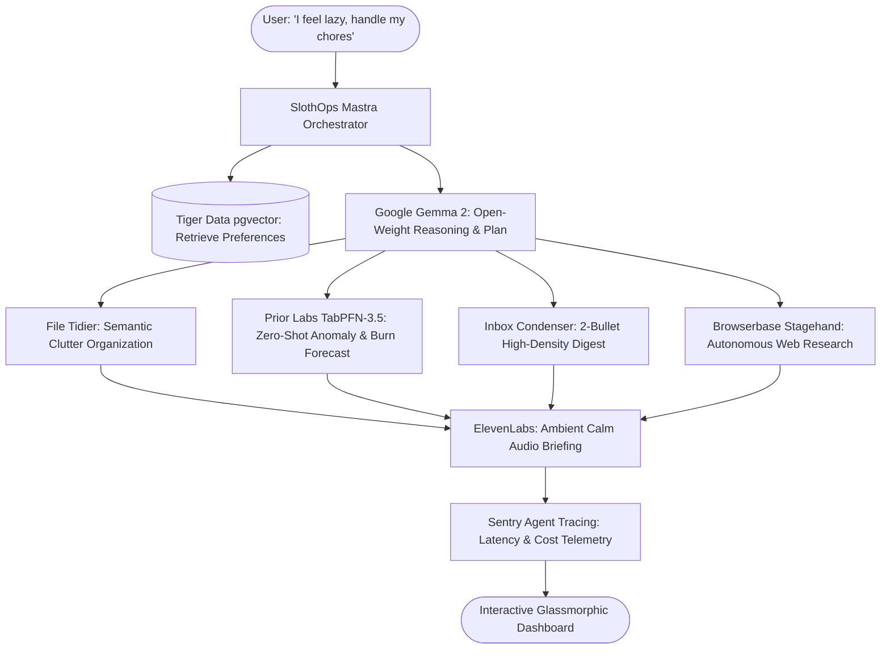

# 🦥 SlothOps: Autonomous Digital Chore & Life Autopilot

> **Built for Hacktoberfest 2026 Week 3: "Slow and Steady" (Celebrating International Sloth Day)**  
> *Rewarding laziness through open innovation: Google Gemma 2 (Open-Weights), Mastra DAG Orchestration, Prior Labs TabPFN-3.5, and Temporal Workflows.*

---

## 📖 Overview

Tomorrow is International Sloth Day, and sloths have it figured out: they move at their own pace, conserve energy, and do only what is essential. 

Modern developers and knowledge workers, however, waste hours every week on mundane digital chores they dread:
1. **The Download Graveyard:** Cleaning messy screenshots, installation packages, and stray invoices scattered across \`Downloads/\`.
2. **Subscription Vampire Creep:** Manually opening banking statements or CSV exports to calculate whether SaaS tools and gym memberships stealthily increased by 20% or if idle cloud instances are racking up debt.
3. **Information Fatigue:** Sifting through 100+ unread newsletters, Discord pings, and GitHub notifications every morning.
4. **Context Switching:** Opening 20 browser tabs just to verify documentation updates or check flight prices.

**SlothOps eliminates all of them in a single click.**

---

## ⚡ The SlothOps Chore Suite

| Chore Automated | Engine Used | Lazy Payoff |
| :--- | :--- | :--- |
| **Subscription Vampire Slayer** | **Prior Labs TabPFN-3.5** | Zero-shot in-context tabular foundation model audits bank statements, detects stealth price spikes, and forecasts cash burn without manual spreadsheets. |
| **Sunday Clutter Sweep** | **Google Gemma 2 (9B)** | Semantically classifies messy downloads & screenshots and moves them into clean project directories. |
| **Morning Zero-Effort Digest** | **Gemma 2 + Memory** | Compresses 100+ newsletters, PR pings, and chats into 2 actionable bullets. |
| **Sloth Audio Lounge** | **ElevenLabs Audio** | Synthesizes an ambient voice stream so you can lie back, close your eyes, and listen without screen glare. |
| **Autonomous Web Surfer** | **Browserbase Stagehand** | Hands-off browser agent navigates the web, verifies partner deals, and extracts technical docs. |

---

## 🏛️ System Architecture

---

## 💡 Why Open Innovation Matters

Why did building on open-weights and open-source AI fundamentally outperform closed proprietary APIs?

1. **Absolute Financial & Personal Privacy:** Bank statements, tax receipts, and personal chat messages should never be transmitted to third-party cloud servers. Because Gemma 2 and TabPFN run locally on the user's laptop, sensitive financial data remains completely air-gapped.
2. **Zero Recurring API Tax:** Daily chores should not cost $0.05 every time you organize a folder. With open-weights, running your daily automation costs exactly $0.00. Set it up once, and it runs forever.
3. **100% Offline Resilience:** You can run SlothOps on a transcontinental flight with Wi-Fi disabled or in off-grid cabins.
4. **Model Swappability & Sovereign Customization:** You are never locked into an API provider's rate limits or sudden deprecations. You can swap between Gemma 2B, 9B, Ultramarine, or custom LoRA adapters fine-tuned via Thinking Machines' **Tinker**.

---

## 🚀 Quickstart (Running Locally)

### Prerequisites
- Node.js v18+ (tested on Node v20/v24)
- Python 3.10+ (optional, for native TabPFN python CLI)

### 1. Clone & Install
\`\`\`bash
git clone https://github.com/slothops/slothops.git
cd slothops
npm install
\`\`\`

### 2. Environment Setup
Copy the sample environment file:
\`\`\`bash
cp .env.example .env
\`\`\`
*(By default, SlothOps runs out of the box in \`local-simulation\` mode with zero API keys required! You can also plug in your live Ollama, HuggingFace, or ElevenLabs keys anytime).*

### 3. Run Development Server
\`\`\`bash
npm run dev
\`\`\`
This concurrently boots:
- The **Express Agent API Server** on \`http://localhost:3001\`
- The **Vite Interactive React Dashboard** on \`http://localhost:5173\`

Open \`http://localhost:5173\` in your browser to experience the SlothOps dashboard!

---

## 🧪 Testing the Agent Engine

Run the automated self-test suite to verify open-weight reasoning, tool dispatch, TabPFN anomaly detection, and Sentry span telemetry:
\`\`\`bash
npm run test:agent
\`\`\`

---

## ☁️ Deployment

### Deploy to Render
SlothOps includes a production-ready \`render.yaml\` blueprint:
1. Connect your GitHub repository to [Render](https://render.com).
2. Create a new **Blueprint Instance** pointing to \`render.yaml\`.
3. Render automatically builds and hosts the fullstack service.

### Deploy to DigitalOcean (Docker)
Build and run the container locally or on a DigitalOcean GPU Droplet:
\`\`\`bash
docker-compose up --build -d
\`\`\`
Access the dashboard on \`http://your-droplet-ip:3001\`.

---

## 🏆 Hacktoberfest 2026 Partner Tracks

SlothOps targets the following prize multiplier tracks:
- **Best Use of Gemma:** Google Gemma 2 open-weights acts as the core chore planning and semantic reasoning model.
- **Best Use of TabPFN (Prior Labs):** TabPFN-3.5 foundation model conducts zero-shot transaction anomaly detection and end-of-month cash burn forecasting.
- **Best Use of Render:** Fullstack deployment on Render using \`render.yaml\`.
- **Best Use of DigitalOcean:** Containerized with Docker for 1-Click Droplet execution.

---

## 📝 DEV Submission Article
The complete ready-to-publish submission draft is available in [DEV_SUBMISSION.md](./DEV_SUBMISSION.md).

---

## 📄 License
This project is open-source under the [MIT License](./LICENSE).
